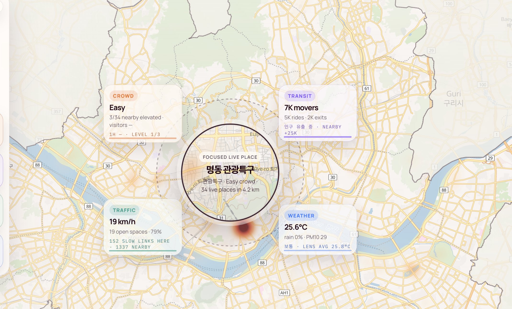
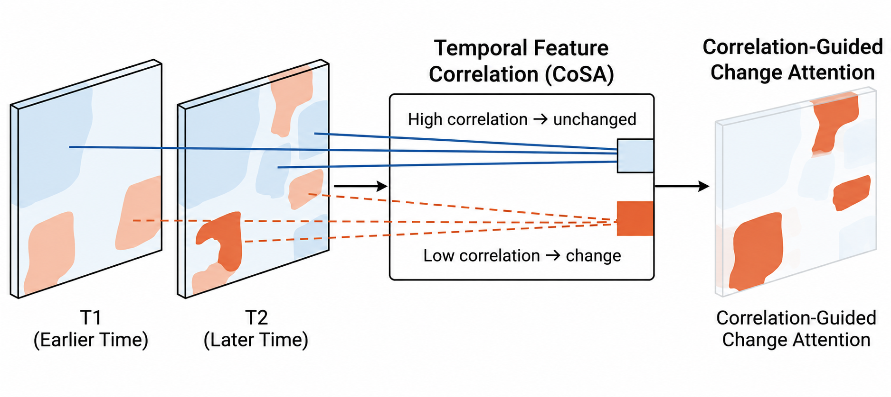
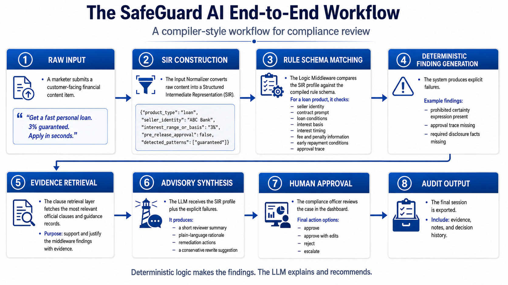
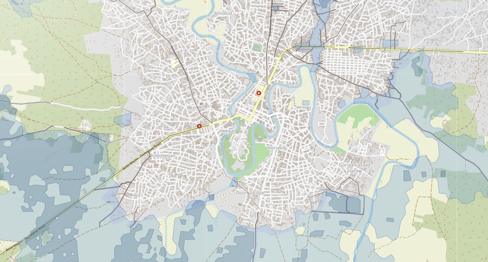

Hello!

I'm Abdirashid Omar, a computer vision researcher from Somalia. I completed a research master's in Data Science at Kookmin University in 2026, supported by the Global Korea Scholarship.

My research asks how visual models can tell real change apart from changes in how a scene was observed. Most of my work applies deep learning to Earth observation: change detection in aerial and satellite imagery, including CoSA (IEEE Access, 2026) and UrbanCDNet, and flood mapping with Sentinel-1 and Sentinel-2. I have also worked on scenes with people, including multi-camera person re-identification and pose estimation, and I now work with 3D data from repeated drone surveys of mining sites.

I care about careful evaluation: auditing data before training, locking test splits, and releasing code with each paper.

I am now looking for a PhD in computer vision, focused on scene understanding and change over time, in 2D and 3D. I wrote more about the transition in [Graduating from Kookmin University: Building a Research Path in Vision AI and GeoAI](/blog/kookmin-graduation/).

# Featured work

  <a class="featured-talk-card" href="https://rashiedomar.github.io/seoul-city-lens/" target="_blank" rel="noopener">
    
      
    
    Seoul Live City Lens
    Live dashboard · Public urban data
  </a>

  <a class="featured-talk-card" href="https://ieeexplore.ieee.org/document/11558270" target="_blank" rel="noopener">
    
      
    
    CoSA Research
    IEEE Access · Remote sensing
  </a>

  <a class="featured-talk-card" href="https://rashiedomar.github.io/FinTech/dashboard/ch4_runtime_flow/" target="_blank" rel="noopener">
    
      
    
    FINCPA Compliance Data Pipeline
    Runtime dashboard · Compliance AI
  </a>

  <a class="featured-talk-card" href="https://rashiedomar.github.io/listen-to-the-river/" target="_blank" rel="noopener">
    
      
    
    Listen to the River
    Live dashboard · Flood impact mapping
  </a>

